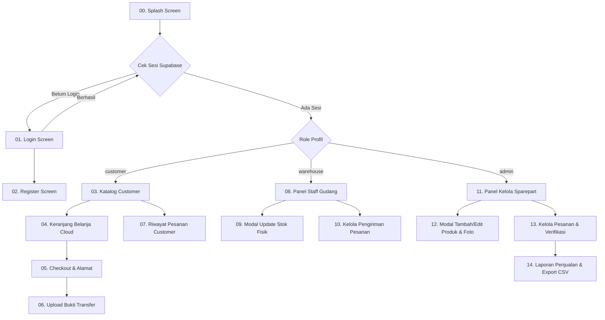

# Design & UI/UX Specification: OEM Spare Parts Catalog
> **Figma Make & Hand-off Specification Document**  
> Versi: 2.0 (Fase 2 — Multi-Role & Realtime Cloud Cart)  
> Target Platform: Mobile (Android / iOS) & Desktop/Web Responsive

---

## 1. Design System & Style Guide (Figma Tokens)

### 1.1 Color Palette
Gunakan token warna berikut untuk Color Styles di Figma:

| Token Name | Hex Code | Deskripsi & Penggunaan |
| :--- | :--- | :--- |
| `primary` | `#D32F2F` | Racing / Automotive Red (Colors.red[700]) — Tombol aksi utama, Brand Accent, Header |
| `primary-hover` | `#B71C1C` | Dark Red — State pressed / hover tombol utama |
| `primary-container` | `#FFEBEE` | Light Red Tint — Background badge aktif, chip highlight, subtle accent |
| `surface` | `#FFFFFF` | Background kartu, modal dialog, pop-up container |
| `background` | `#FAFAFA` | App scaffold background (Light neutral / clean grey) |
| `text-primary` | `#1A1C1E` | Heading, nama sparepart, label penting |
| `text-secondary` | `#6C757D` | Part number, timestamp, subtitle, hints |
| `success` | `#2E7D32` | Status "Selesai", nominal harga, tag verified |
| `warning` | `#ED6C02` | Status "Menunggu / Pending", peringatan stok minim |
| `danger` | `#C62828` | Status "Dibatalkan", tombol Hapus, tag ditolak |
| `border` | `#E0E0E0` | Card border, divider, input stroke |

### 1.2 Typography (Material Design 3 Scale)
Font Family: **Roboto** (Android/Web) atau **Inter**

* **Display / Headline:** SemiBold 20pt / Line Height 28pt (AppBar, Dialog Title)
* **Title Medium:** SemiBold 16pt / Line Height 24pt (Card Title, Section Header)
* **Body Regular:** Regular 14pt / Line Height 20pt (Form Input, Text Body)
* **Body Small / Caption:** Regular 11pt - 12pt / Line Height 16pt (Part Number, Badge, Meta)
* **Price Emphasis:** Bold 15pt - 18pt / Line Height 22pt (`success` color)

### 1.3 UI Components Standard (Figma Atoms)
* **Corner Radius:**
  * Card: `12px`
  * Buttons & Inputs: `10px`
  * Dialog / Bottom Sheet: `16px`
  * Badges / Status Chips: `16px` (Pill shape)
* **Elevation / Shadows:**
  * Card: Y: 2, Blur: 6, Opacity: 6% (`#00000010`)
  * Floating Action Button (FAB): Y: 4, Blur: 10, Opacity: 15%
* **Grid Spacing:** 8pt grid system (Padding: 4, 8, 12, 16, 24).

---

## 2. Information Architecture & User Flow

---

## 3. Screen Breakdown & Figma Frame Specifications

### Screen 01 & 02: Autentikasi (Login & Register)
* **Frame:** Mobile 390 x 844 px
* **Elemen UI:**
  * Logo Icon OEM Sparepart + Title
  * Segmented / Tab: Masuk vs Daftar
  * Input Fields: Email / Username, Password (dengan toggle visibility eye icon)
  * Primary Button: "Masuk" / "Daftar Akun"
  * Feedback state: Banner Error / Loading indicator

---

### Screen 03: Katalog Sparepart (Customer)
* **Frame:** Mobile 390 x 844 px (atau Desktop Grid responsive)
* **Header / AppBar:**
  * Kiri: Greeting `"Halo, [Username]"`
  * Kanan: Icon Riwayat Pesanan (`Icons.receipt_long`), Cart Icon dengan Badge jumlah item realtime (`Icons.shopping_cart`), Tombol Logout
* **Search Bar:**
  * Sticky di bawah AppBar: Search Input dengan icon kaca pembesar dan tombol reset clear `(X)`.
* **Product Grid (2 Kolom):**
  * **Card Container:**
    * Product Image (1:1 Aspect ratio, fallback placeholder icon sparepart).
    * Nama Sparepart (Max 1 baris, ellipsis).
    * Part Number badge (`PN: 12345-ABC`).
    * Baris Bawah: Harga (`$XX.XX` hijau tebal) & Label Stok (`Stock: XX`).
    * Button: Full width `"Tambah"` (+ keranjang). State `Disabled` jika stok = 0.

---

### Screen 04 & 05: Keranjang Belanja & Checkout (Customer)
* **Status:** Tersimpan permanen ke Cloud Database (Supabase `cart_items`).
* **Elemen UI:**
  * **List Item:**
    * Thumbnail kecil (opsional), Nama produk, subtotal kalkulasi (`$price x qty = $subtotal`).
    * Stepper kuantitas: `[-]` [ Angka ] `[+]` (Otomatis disable tombol `+` saat mencapai limit stok gudang atau batas max 99).
  * **Section Alamat Pengiriman:**
    * Input Nama Penerima, No. Telepon/WA, Alamat Lengkap.
  * **Pilihan Kurir / Shipping Option:**
    * Radio card / dropdown kurir pengiriman beserta ongkos kirim.
  * **Sticky Bottom Bar:**
    * Total Bayar (Total item + Ongkir).
    * Tombol Primary `"Checkout Sekarang"`.

---

### Screen 06 & 07: Pembayaran & Riwayat Pesanan (Customer)
* **Upload Bukti Bayar:**
  * Info rekening transfer bank & instruksi pembayaran.
  * Tombol ambil foto / upload gambar dari galeri.
  * Tombol kirim konfirmasi transfer.
* **Riwayat Pesanan:**
  * Accordion card: Nomor pesanan (`#XXXX`), Tanggal transaksi, Total biaya, Badge Status (`Menunggu`, `Selesai`, `Dibatalkan`).
  * Detail expandable: Daftar item yang dipesan, alamat tujuan, status verifikasi pembayaran (`Belum Bayar`, `Bukti Terkirim`, `Terverifikasi`, `Ditolak`).

---

### Screen 08 & 09: Panel Staff Gudang (`warehouse`)
* **Tujuan Desain:** Efisiensi operasional staf gudang (Stock Keeper).
* **Header:** Title `"Staff Gudang - [Nama]"` + Icon Menu Pesanan & Logout.
* **List Katalog Sparepart:**
  * Avatar foto produk, Nama sparepart, Part number, Stok saat ini.
  * **Aksi Dibatasi:** **TIDAK ADA** tombol Tambah Barang baru, **TIDAK ADA** tombol Hapus, tidak ada akses edit harga.
  * Tombol Aksi: Icon Box Gudang `[Update Stok]`.
* **Modal Update Stok:**
  * Info preview barang: Nama & Part Number (Read-only).
  * Field tunggal: `[Jumlah Stok Gudang]` (Number keyboard).
  * Tombol: `"Batal"` & `"Simpan Stok"`.

---

### Screen 11 & 12: Panel Admin Penuh (`admin`)
* **Header:** Title `"Admin - [Nama]"` + Icon Kelola Pesanan + Logout.
* **Floating Action Button (FAB):** `[+ Tambah Sparepart]`.
* **List Katalog Sparepart:**
  * Menampilkan foto, nama, part number, harga, stok.
  * Tombol Aksi di setiap baris:
    * `[Edit]` (Buka modal lengkap: Ubah nama, part number, kategori, harga, stok, & upload gambar baru).
    * `[Hapus]` (Warna merah + dialog konfirmasi bahaya sebelum delete).

---

### Screen 13: Kelola Pesanan (Admin & Staff Gudang)
* **Akses:** Admin Penuh & Staff Gudang (dengan pembedaan tombol).
* **List Card Pesanan (Realtime Stream):**
  * Expansion card: ID pesanan, Nama pemesan, Alamat, No. Telp, Total belanja.
  * Item breakdown (daftar sparepart dan kuantitas).
  * **Segment Status Pesanan:** Toggle chip `[Menunggu]` | `[Selesai]` | `[Dibatalkan]`.
  * **Segment Pembayaran:**
    * Status badge: `Belum Bayar` / `Bukti Terkirim` / `Terverifikasi` / `Ditolak`.
    * Tombol `"Lihat Bukti"` (Membuka popup foto bukti transfer via secure signed-URL).
    * **Khusus Admin Penuh:** Tombol aksi `[Verifikasi]` (Hijau) & `[Tolak]` (Merah). Tombol ini tersembunyi bagi staff gudang.
  * **Khusus Admin Penuh di AppBar:** Tombol icon grafik/dokumen menuju **Laporan Penjualan**.

---

### Screen 14: Laporan Penjualan & Export CSV (Admin Penuh)
* **Header:** Title `"Laporan Penjualan"` + Action Icon `[Export CSV]`.
* **Filter Bar:**
  * Date Picker: `Dari [Tanggal]` & `Sampai [Tanggal]`.
  * Dropdown Status: `Semua` | `Selesai` | `Menunggu` | `Dibatalkan`.
* **Summary Widget (2 Kolom):**
  * Box 1: Total Transaksi (`X Transaksi`).
  * Box 2: Total Omset Selesai (`$XX,XXX.XX` warna hijau tebal).
* **Tabel / List Transaksi Penjualan:**
  * Baris pesanan lengkap dengan ID ringkas, nama pelanggan, tanggal transaksi, status, dan nominal total.
* **Modal Dialog Export CSV:**
  * Box pratinjau teks CSV (monospace font).
  * Ringkasan baris data yang siap diekspor.
  * Tombol CTA: `"Salin ke Clipboard"` (Dengan snackbar notifikasi siap paste ke Excel / Google Sheets).

---

## 4. Permission Matrix (Role-Based Access Control)

| Fitur / Layanan | Customer | Staff Gudang (`warehouse`) | Admin Penuh (`admin`) |
| :--- | :---: | :---: | :---: |
| Lihat Katalog & Cari TF-IDF | Ya | Ya | Ya |
| Keranjang Belanja Cloud (`cart_items`) | Ya | Tidak | Tidak |
| Checkout & Buat Pesanan | Ya | Tidak | Tidak |
| Riwayat Pesanan Pribadi | Ya | Tidak | Tidak |
| Lihat Semua Pesanan Masuk | Tidak | Ya | Ya |
| Ubah Status Kirim/Pesanan | Tidak | Ya | Ya |
| Lihat Bukti Transfer | Tidak | Ya | Ya |
| Verifikasi / Tolak Pembayaran | Tidak | Tidak | **Ya** |
| Update Jumlah Stok Barang | Tidak | **Ya** | **Ya** |
| Tambah / Edit Detail / Hapus Produk | Tidak | Tidak | **Ya** |
| Akses Laporan & Export CSV | Tidak | Tidak | **Ya** |

---

## 5. Rekomendasi Layout Figma Auto-Layout
Untuk mempermudah pembuatan di Figma:
1. **Product Card:** Gunakan Auto-Layout vertikal (`padding: 10px`, `spacing: 8px`), Image fill width dengan fixed aspect ratio, dan tombol aksi pin di bagian bottom.
2. **Badge / Chip:** Auto-layout horizontal (`padding-x: 8px`, `padding-y: 4px`, `corner-radius: 16px`).
3. **Data Rows / Order Tile:** Auto-layout horizontal dengan `space-between` alignment untuk nama item dan harga.
4. **Export Dialog:** Auto-layout vertikal dengan input preview `max-width: 100%` scrollable.