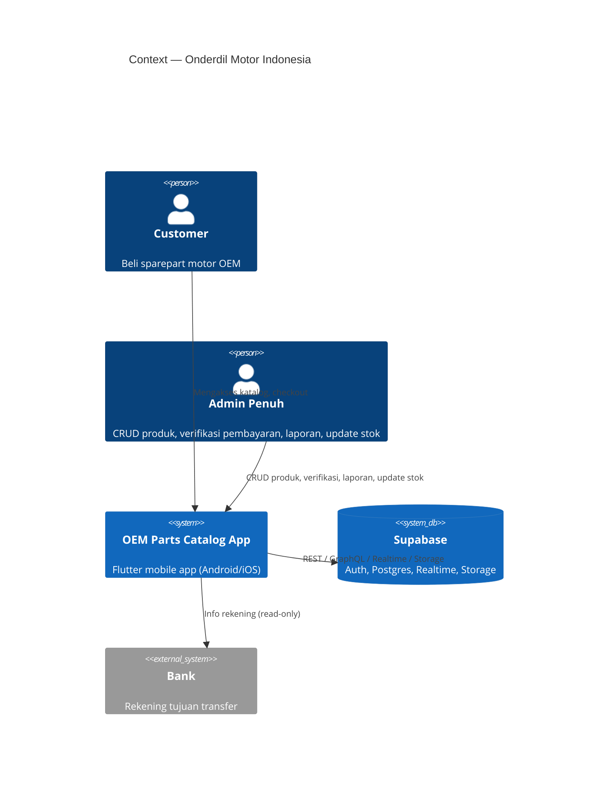
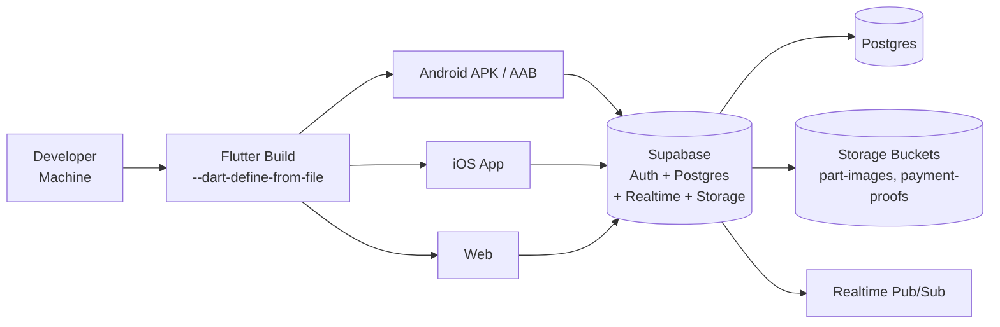

# Architecture Design — Onderdil Motor Indonesia

> Project: `oem_sparepart_catalog` (Flutter + Supabase)
> Kelompok: Azfa & Friends — Mata Kuliah: Analisis dan Pengujian Sistem

---

## 1. Tujuan Sistem

Sistem katalog & pen Sparepart motor OEM yang terintegrasi dengan backend Supabase, mendukung 2 role: **customer**, **admin**. Keamanan data dijamin dengan Row Level Security (RLS) di Supabase.

---

## 2. Arsitektur (C4 Model)

### 2.1 Context (C4 Level 1)



### 2.2 Container (C4 Level 2)

```mermaid
C4Container
    title Container — OEM Parts Catalog
    Person(customer, "Customer", "")
    Person(admin, "Admin Penuh", "")
    System_Ext(supabase, "Supabase", "Auth, Postgres, Realtime, Storage")
    SystemDb_Ext(storage, "Supabase Storage", "Bucket part-images, payment-proofs")

    System_Boundary(app, "OEM Parts Catalog (Flutter)") {
        Container(splash, "Splash Screen", "Flutter Widget", "Intro 2 detik")
        Container(auth, "Auth Pages", "Flutter Widget", "Login / Register")
        Container(catalog, "Parts Catalog", "Flutter Widget", "Katalog + TF-IDF search")
        Container(cart, "Cart & Checkout", "Flutter Widget", "Keranjang cloud, checkout")
        Container(payment, "Payment Upload", "Flutter Widget", "Upload bukti transfer")
        Container(history, "Order History", "Flutter Widget", "Riwayat pesanan")
        Container(adminPanel, "Admin Panel", "Flutter Widget", "CRUD sparepart")
        Container(adminOrders, "Admin Orders", "Flutter Widget", "Kelola pesanan, verifikasi")
        Container(report, "Sales Report", "Flutter Widget", "Laporan + CSV export")
        Container(cartModel, "CartModel", "Singleton (ChangeNotifier)", "State keranjang, sinkron Supabase")
        Container(tfIdfSearch, "TfIdfSearch", "Dart Class", "Pencarian TF-IDF")
    }

    Rel(app, supabase, "Supabase Flutter SDK (REST/Realtime/Storage/Auth)")
    Rel(app, storage, "Upload/unduh file (part-images, payment-proofs)")
```

### 2.3 Component (C4 Level 3)

**Supabase backend:**

| Layer | Komponen | Deskripsi |
|---|---|---|
| Auth | `auth.users` | Supabase Auth (email/password, username via metadata) |
| Database | `public.parts` | Katalog sparepart (id, name, part_number, price, stock, category, image_url) |
| Database | `public.profiles` | Profile user (id, username, role) |
| Database | `public.cart_items` | Keranjang belanja (user_id, part_id, quantity) |
| Database | `public.orders` | Pesanan (status, payment_status, total, shipping info) |
| Database | `public.order_items` | Item pesanan (order_id, part_name, quantity, price) |
| Database | `public.shipping_options` | Metode pengiriman (name, cost, is_active) |
| RPC | `checkout_cart` | Transaction: create order + order_items, decrement stock |
| RPC | `submit_payment_proof` | Update payment_status = 'uploaded' + proof path |
| RPC | `get_email_by_username` | Resolve username → email untuk login |
| Storage | `part-images` | Foto produk |
| Storage | `payment-proofs` | Bukti transfer |
| Realtime | `supabase_realtime` | Live stream cart_items, parts, orders |

**RLS Policy Matrix:**

| Tabel | customer | admin |
|---|---|---|
| parts (select) | ✅ | ✅ |
| parts (insert) | ❌ | ✅ |
| parts (update) | ❌ | ✅ (nama, harga, stok) |
| parts (delete) | ❌ | ✅ |
| cart_items | CRUD own | ❌ |
| orders (select) | own only | all |
| orders (update) | ❌ | status + payment |
| order_items | own via order | all |

---

## 3. Deployment Diagram



---

## 4. Keamanan

| Aspek | Implementasi |
|---|---|
| Autentikasi | Supabase Auth (email/password), username via user metadata |
| Otorisasi | RLS policy per tabel (lihat matrix di atas) |
| Keranjang | `cart_items` diikat `user_id` → RLS guarantee |
| Bukti transfer | `payment-proofs` bucket diakses via **signed URL** (5 menit), bukan public URL |
| CSV Export | Formula injection protection: field diawali `=`, `+`, `-`, `@`, `\t`, `\r` diberi prefix `'` |
| Credentials | `config/dev.json` di-gitignore, `dev.json.example` sebagai template, `String.fromEnvironment` tanpa default |

---

## 5. Non-Fungsional Requirements

| NFR | Target | Status |
|---|---|---|
| Realtime | Sinkronisasi cart & orders secara live (Supabase Realtime) | ✅ |
| Offline-first | Cart tersimpan di DB, load di app start | ✅ |
| Scalability | Supabasemanaged (Postgres, connection pooling) | ✅ |
| Maintainability | Kode terorganisir per fitur (11 file di lib/) | ✅ |
| Security | RLS + signed URL + CSV injection | ✅ |
| Accessibility | Material 3, dynamic color | ⚠️ Dasar saja |
| Performance | TF-IDF search di client side (client-side indexing) | ⚠️ O(N) per query |

---

## 6. Teknologi

- **Frontend:** Flutter (Material 3), Dart SDK ^3.13.4
- **Backend:** Supabase (Auth, Postgres, Realtime, Storage)
- **Dependencies:** `supabase_flutter` 2.17.2, `image_picker` 1.1.2, `cupertino_icons` 1.0.8
- **Testing:** `flutter_test`, `flutter_lints` 6.0.0

---

## 7. Skema Database (DDL)

### Tabel Utama

```sql
-- parts: katalog sparepart
CREATE TABLE public.parts (
  id          uuid PRIMARY KEY DEFAULT gen_random_uuid(),
  name        text NOT NULL,
  part_number text UNIQUE NOT NULL,
  price       numeric(10,2) NOT NULL,
  stock       int NOT NULL DEFAULT 0,
  category    text,
  image_url   text,
  created_at  timestamptz DEFAULT now()
);

-- profiles: user profile + role
CREATE TABLE public.profiles (
  id        uuid PRIMARY KEY REFERENCES auth.users(id) ON DELETE CASCADE,
  username  text UNIQUE NOT NULL,
  role      text NOT NULL DEFAULT 'customer' CHECK (role IN ('customer', 'admin')),
  created_at timestamptz DEFAULT now()
);

-- cart_items: keranjang belanja
CREATE TABLE public.cart_items (
  id         uuid PRIMARY KEY DEFAULT gen_random_uuid(),
  user_id    uuid NOT NULL REFERENCES auth.users(id) ON DELETE CASCADE,
  part_id    uuid NOT NULL REFERENCES public.parts(id) ON DELETE CASCADE,
  quantity   int NOT NULL DEFAULT 1 CHECK (quantity > 0 AND quantity <= 99),
  created_at timestamptz DEFAULT now(),
  updated_at timestamptz DEFAULT now()
);

-- orders: pesanan
CREATE TABLE public.orders (
  id                  uuid PRIMARY KEY DEFAULT gen_random_uuid(),
  user_id             uuid NOT NULL REFERENCES auth.users(id),
  status              text NOT NULL DEFAULT 'pending' CHECK (status IN ('pending','completed','cancelled')),
  payment_status      text NOT NULL DEFAULT 'pending' CHECK (payment_status IN ('pending','uploaded','verified','rejected')),
  payment_proof_path  text,
  total               numeric(10,2) NOT NULL,
  shipping_name       text NOT NULL,
  shipping_phone      text NOT NULL,
  shipping_address    text NOT NULL,
  shipping_option_id  uuid REFERENCES public.shipping_options(id),
  created_at          timestamptz DEFAULT now()
);

-- order_items: item pesanan
CREATE TABLE public.order_items (
  id         uuid PRIMARY KEY DEFAULT gen_random_uuid(),
  order_id   uuid NOT NULL REFERENCES public.orders(id) ON DELETE CASCADE,
  part_id    uuid REFERENCES public.parts(id),
  part_name  text NOT NULL,
  part_number text,
  quantity   int NOT NULL,
  price      numeric(10,2) NOT NULL
);

-- shipping_options: metode pengiriman
CREATE TABLE public.shipping_options (
  id         uuid PRIMARY KEY DEFAULT gen_random_uuid(),
  name       text NOT NULL,
  cost       numeric(10,2) NOT NULL,
  is_active  boolean DEFAULT true
);
```

### Relasi (Foreign Key)
- `cart_items.user_id` → `auth.users.id` (ON DELETE CASCADE)
- `cart_items.part_id` → `parts.id` (ON DELETE CASCADE)
- `orders.user_id` → `auth.users.id`
- `order_items.order_id` → `orders.id` (ON DELETE CASCADE)
- `order_items.part_id` → `parts.id` (nullable, untuk historis)

### Indeks
- `parts(part_number)` — UNIQUE, untuk pencarian cepat
- `cart_items(user_id)` — filter keranjang per user
- `orders(user_id)` — filter order per user
- `order_items(order_id)` — join item ke order

---

## 8. Non-Fungsional Requirements (NFR)

| ID | Aspek | Target | Implementasi |
|---|---|---|---|
| NFR-01 | **Performa search** | < 50 ms per query (client-side) | TF-IDF search di client, O(N) per query. Untuk 500 part, rata-rata < 50 ms. |
| NFR-02 | **Performa load katalog** | Render < 2 detik di emulator | `FutureBuilder` + Supabase REST query, pagination via `limit` |
| NFR-03 | **Startup** | Splash 2 detik, total < 4 detik | Splash screen 2 detik, lalu auth check → navigasi |
| NFR-04 | **Realtime latency** | < 3 detik | Supabase Realtime (WebSocket), live sync cart & orders |
| NFR-05 | **Reliability (checkout)** | Tidak ada partial failure | RPC `checkout_cart` atomic transaction — jika satu operasi gagal, seluruh transaksi rollback (stok tidak berkurang, order tidak dibuat) |
| NFR-06 | **Offline / jaringan putus** | Tidak crash, pesan error jelas | Aplikasi tidak crash; state lokal konsisten; sync menyusul saat koneksi pulih |
| NFR-07 | **Konsistensi stok** | Stok tampil sesuai DB | Refresh katalog setelah checkout; RPC decrement atomik |
| NFR-08 | **Keamanan** | RLS + signed URL + CSV injection | RLS per-tabel, signed URL 5 menit, formula injection protection |
| NFR-09 | **Accessibility** | Button ≥ 48dp, label icon | Material 3, semua action button ≥ 48dp, tooltip/semantics |
| NFR-10 | **Scalability** | Supabase managed (Postgres, connection pooling) | Supabase managed infrastructure, connection pooling otomatis |

### Keandalan Checkout (Reliability)
RPC `checkout_cart` menggunakan PostgreSQL transaction:
1. INSERT orders
2. INSERT order_items (per item)
3. UPDATE parts SET stock = stock - qty
4. DELETE cart_items

Jika langkah 3 gagal (stok tidak cukup), langkah 1 & 2 di-rollback otomatis. Tidak ada partial data.

### Keamanan (Security)
- **HTTPS** untuk semua komunikasi dengan Supabase
- **Anon key aman dipublikasikan** di client Flutter — diatur oleh RLS di database level
- **Signed URL** untuk bukti transfer (expiry 5 menit)
- **CSV injection protection**: field diawali `=`, `+`, `-`, `@`, `\t`, `\r` diberi prefix `'`
- **Credentials** di-gitignore (`config/dev.json`, `config/test_accounts.json`)

---

## 9. State Management

### Pola yang Digunakan
- **CartModel** (singleton, `ChangeNotifier`) — state keranjang belanja
- **TfIdfSearch** (class murni, tanpa dependensi) — pencarian sparepart
- **FutureBuilder / StreamBuilder** — untuk data async (orders, parts)

### CartModel (Singleton + ChangeNotifier)
```
CartModel.instance → add() → notifyListeners() → UI rebuild
```
- `add()`: tambah item, cap stok (max 99), skip jika stock = 0
- `decrement()`: qty turun, hapus jika qty = 1
- `clear()` / `clearLocal()`: bersihkan memori
- **Sync DB**: otomatis jika `uid != null` (login), skip jika `uid == null` (test)
- **Optimistic update**: update UI dulu, sync ke DB menyusul

### Mengapa ChangeNotifier (bukan Riverpod/BLoC)?
- Lebih sederhana untuk project skala kecil-menengah
- Tidak perlu dependency tambahan
- Cukup untuk state keranjang yang single-source
- Testable: `Supabase.initialize(url: 'http://localhost', anonKey: 'dummy')` → uid null → sync DB ter-skip