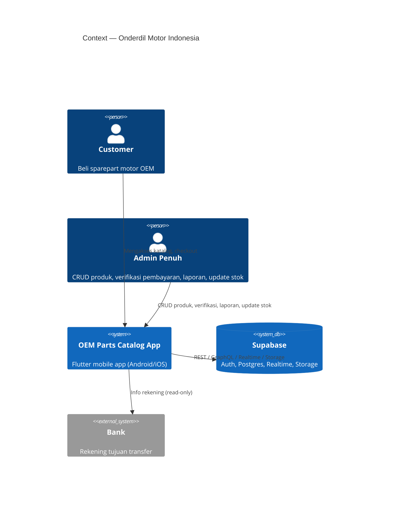
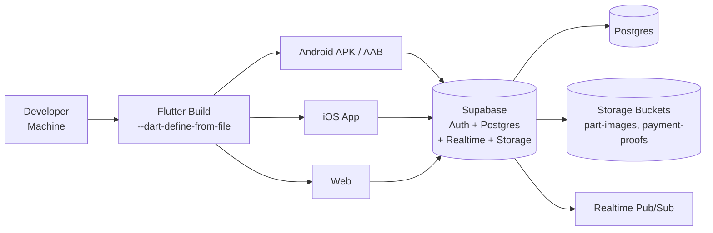

# Architecture Design — Onderdil Motor Indonesia

> Project: `oem_sparepart_catalog` (Flutter + Supabase)
> Kelompok: Azfa & Friends — Mata Kuliah: Analisis dan Pengujian Sistem

---

## 1. Tujuan Sistem

Sistem katalog & pen Sparepart motor OEM yang terintegrasi dengan backend Supabase, mendukung 2 role: **customer**, **admin**. Keamanan data dijamin dengan Row Level Security (RLS) di Supabase.

---

## 2. Arsitektur (C4 Model)

### 2.1 Context (C4 Level 1)



### 2.2 Container (C4 Level 2)

```mermaid
C4Container
    title Container — OEM Parts Catalog
    Person(customer, "Customer", "")
    Person(admin, "Admin Penuh", "")
    System_Ext(supabase, "Supabase", "Auth, Postgres, Realtime, Storage")
    SystemDb_Ext(storage, "Supabase Storage", "Bucket part-images, payment-proofs")

    System_Boundary(app, "OEM Parts Catalog (Flutter)") {
        Container(splash, "Splash Screen", "Flutter Widget", "Intro 2 detik")
        Container(auth, "Auth Pages", "Flutter Widget", "Login / Register")
        Container(catalog, "Parts Catalog", "Flutter Widget", "Katalog + TF-IDF search")
        Container(cart, "Cart & Checkout", "Flutter Widget", "Keranjang cloud, checkout")
        Container(payment, "Payment Upload", "Flutter Widget", "Upload bukti transfer")
        Container(history, "Order History", "Flutter Widget", "Riwayat pesanan")
        Container(adminPanel, "Admin Panel", "Flutter Widget", "CRUD sparepart")
        Container(adminOrders, "Admin Orders", "Flutter Widget", "Kelola pesanan, verifikasi")
        Container(report, "Sales Report", "Flutter Widget", "Laporan + CSV export")
        Container(cartModel, "CartModel", "Singleton (ChangeNotifier)", "State keranjang, sinkron Supabase")
        Container(tfIdfSearch, "TfIdfSearch", "Dart Class", "Pencarian TF-IDF")
    }

    Rel(app, supabase, "Supabase Flutter SDK (REST/Realtime/Storage/Auth)")
    Rel(app, storage, "Upload/unduh file (part-images, payment-proofs)")
```

### 2.3 Component (C4 Level 3)

**Supabase backend:**

| Layer | Komponen | Deskripsi |
|---|---|---|
| Auth | `auth.users` | Supabase Auth (email/password, username via metadata) |
| Database | `public.parts` | Katalog sparepart (id, name, part_number, price, stock, category, image_url) |
| Database | `public.profiles` | Profile user (id, username, role) |
| Database | `public.cart_items` | Keranjang belanja (user_id, part_id, quantity) |
| Database | `public.orders` | Pesanan (status, payment_status, total, shipping info) |
| Database | `public.order_items` | Item pesanan (order_id, part_name, quantity, price) |
| Database | `public.shipping_options` | Metode pengiriman (name, cost, is_active) |
| RPC | `checkout_cart` | Transaction: create order + order_items, decrement stock |
| RPC | `submit_payment_proof` | Update payment_status = 'uploaded' + proof path |
| RPC | `get_email_by_username` | Resolve username → email untuk login |
| Storage | `part-images` | Foto produk |
| Storage | `payment-proofs` | Bukti transfer |
| Realtime | `supabase_realtime` | Live stream cart_items, parts, orders |

**RLS Policy Matrix:**

| Tabel | customer | admin |
|---|---|---|
| parts (select) | ✅ | ✅ |
| parts (insert) | ❌ | ✅ |
| parts (update) | ❌ | ✅ (nama, harga, stok) |
| parts (delete) | ❌ | ✅ |
| cart_items | CRUD own | ❌ |
| orders (select) | own only | all |
| orders (update) | ❌ | status + payment |
| order_items | own via order | all |

---

## 3. Deployment Diagram



---

## 4. Keamanan

| Aspek | Implementasi |
|---|---|
| Autentikasi | Supabase Auth (email/password), username via user metadata |
| Otorisasi | RLS policy per tabel (lihat matrix di atas) |
| Keranjang | `cart_items` diikat `user_id` → RLS guarantee |
| Bukti transfer | `payment-proofs` bucket diakses via **signed URL** (5 menit), bukan public URL |
| CSV Export | Formula injection protection: field diawali `=`, `+`, `-`, `@`, `\t`, `\r` diberi prefix `'` |
| Credentials | `config/dev.json` di-gitignore, `dev.json.example` sebagai template, `String.fromEnvironment` tanpa default |

---

## 5. Non-Fungsional Requirements

| NFR | Target | Status |
|---|---|---|
| Realtime | Sinkronisasi cart & orders secara live (Supabase Realtime) | ✅ |
| Offline-first | Cart tersimpan di DB, load di app start | ✅ |
| Scalability | Supabasemanaged (Postgres, connection pooling) | ✅ |
| Maintainability | Kode terorganisir per fitur (11 file di lib/) | ✅ |
| Security | RLS + signed URL + CSV injection | ✅ |
| Accessibility | Material 3, dynamic color | ⚠️ Dasar saja |
| Performance | TF-IDF search di client side (client-side indexing) | ⚠️ O(N) per query |

---

## 6. Teknologi

- **Frontend:** Flutter (Material 3), Dart SDK ^3.13.4
- **Backend:** Supabase (Auth, Postgres, Realtime, Storage)
- **Dependencies:** `supabase_flutter` 2.17.2, `image_picker` 1.1.2, `cupertino_icons` 1.0.8
- **Testing:** `flutter_test`, `flutter_lints` 6.0.0